

<h3><code>avi@github ~ $ ./contributions.sh</code></h3>

 
 

<h3><code>avi@github ~ $ whoami</code></h3>

<table>
<tr>
<td valign="top"></td>
<td valign="top"></td>
</tr>
</table>

 
 

<h3><code>avi@github ~ $ ./links.sh</code></h3>

<b>Fullstack Developer · AI Builder · Instructor</b>

  
  
  
  

 

---

## 01 · About



**0noxtackore** is a developer who builds for the web: broadcasting systems, management platforms, games and developer tools.

---

## 02 · Selected Work



Real products, not assignments - systems shipped and put in front of real users.

---

## 03 · Toolkit



---

## 04 · Videos


<table>
<tr>
<td width="33%">
<h3 align="center">The Python Trick That Saves You HOURS</h3>

  

</td>

<td width="33%">
<h3 align="center">The JS Keyword Nobody Uses</h3>

  

</td>

<td width="33%">
<h3 align="center">This Java Trick Saves You Hours</h3>

  

</td>
</tr>
<tr>
<td width="33%">
<h3 align="center">CSS Can Do THIS... without JavaScript</h3>

  

</td>

<td width="33%">
<h3 align="center">5 Things You Didn't Know About PHP</h3>

  

</td>

<td width="33%">
<h3 align="center">5 Things You Didn't Know About Ruby</h3>

  

</td>
</tr>
</table>

---

## 05 · Commit Log


  <picture>
    <source media="(prefers-color-scheme: dark)" srcset="https://raw.githubusercontent.com/Pavithran-P12/ReadmePacman/output/pacman-contribution-graph-dark.svg">
    <source media="(prefers-color-scheme: light)" srcset="https://raw.githubusercontent.com/Pavithran-P12/ReadmePacman/output/pacman-contribution-graph.svg">
    
  </picture>

  

---

## 06 · Connect

  
  
  
  

